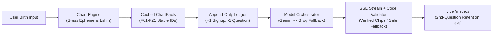

# Melooha AI — Vedic Astrology Q&A

[](https://github.com/melooha-challenge/melooha-ai/actions)
[](https://www.python.org/downloads/)
[](https://fastapi.tiangolo.com)
[](https://react.dev)
[](https://vitejs.dev)
[](LICENSE)

A standalone, mobile-first, Melooha-style AI Vedic astrology application built for the 7–10 day hiring challenge. Designed around **truth in data, strict code grounding, atomic ledger accounting, and production polish**.

---

## 0. Product in One Paragraph
A user enters birth details (date, time, place), gets a mathematically computed Vedic birth chart stored as atomic facts with stable IDs (`F01`–`F21`), and asks life questions (career, relationships, timing). Each question atomically spends from an append-only question balance. New users receive 1 free question upon signup. When balance reaches 0, a clear paywall modal allows topping up questions with no real payment. Answers stream over Server-Sent Events (SSE) and are strictly validated in code: the LLM may **only** cite precomputed facts, with every claim backed by interactive, tappable **Evidence Chips**.

---

## 1. Quickstart (One Command to Run Everything)

### Option A: Docker Compose (Recommended)
Clone the repository and run:
```bash
docker compose up --build
```
Open your browser at **`http://localhost:8000`**.

### Option B: Local Python & Frontend (Fast Dev)
1. **Clone and setup environment**:
   ```bash
   cp .env.example .env
   pip install -r requirements.txt
   ```
2. **Start the application**:
   ```bash
   # Starts backend and serves built mobile-first frontend on port 8000
   uvicorn backend.main:app --reload --port 8000
   ```
3. **Run tests**:
   ```bash
   pytest -v
   ```
   *(All 32 tests pass in < 4 seconds).*

---

## 2. Reused Code vs. What Is New
- **What is Reused**: Nothing from previous projects. Built 100% from scratch for this challenge.
- **External Open-Source Dependencies**:
  - `pysweph` (Swiss Ephemeris Python bindings for planetary coordinates and house cusps).
  - `FastAPI`, `SQLAlchemy 2.0`, `Pydantic v2`, `httpx`.
  - `React 18`, `Vite 6`, `Tailwind CSS`, `lucide-react`, `canvas-confetti`.

---

## 3. Architecture & Core Mechanics



### The 7 Development Phases Completed:
1. **Phase 1: Chart Engine (`chart/`)**
   - Pure-Python module turning `(date, time, place, timezone)` into structured `ChartFacts` with deterministic IDs (`F01` to `F21`).
   - Configured for **Lahiri Sidereal Zodiac**, **Whole-Sign houses**, and **120-year Vimshottari Dasha**.
   - Golden tests against 3 known charts (New Delhi 1980, Mumbai 1995, Bengaluru 2000).
   - **Explicit handling of unknown birth time**: Time-dependent facts (Lagna and houses) are marked unavailable (`is_available: False`). No ungrounded coordinates are ever guessed.
2. **Phase 2: Q&A with Question Balance & Ledger (`backend/ledger.py`)**
   - Relational tables: `users`, `birth_profiles`, `charts`, `balance_ledger`, `questions`, `answers`, `events`.
   - Dynamic balance calculation: $\text{Balance} = \sum \text{amount}$.
   - Atomic and idempotent spending with per-user mutex serialization and row-level locking (`with_for_update()`).
   - 10-thread parallel concurrency stress test verified: exactly 1 succeeds, 9 fail with insufficient balance, final balance strictly 0.
   - Idempotent "+5 Questions Free" top-up without real payment.
3. **Phase 3: Grounded Answers Enforced in Code (`llm/validator.py`)**
   - Prompt contains only `ChartFacts` context; output requires `{answer, cited_fact_ids[], claims[]}`.
   - Code validator verifies:
     1. Every cited ID exists in provided facts and was available.
     2. Regex + dictionary cross-checking that every mentioned planet, sign, house number, dasha lord, and date matches computed ground truth.
     3. On violation: retry once with feedback, then fall back to safe deterministic templated reading built exclusively from verified facts.
4. **Phase 4: Reliable Dual-Provider Failover (`llm/client.py`)**
   - Primary: **Google Gemini API** (`gemini-2.0-flash`).
   - Fallback: **Groq API** (`llama-3.3-70b-versatile`).
   - Independent 3-state Circuit Breaker (`CLOSED`, `OPEN`, `HALF_OPEN`) with cooldown reset.
   - Shielded error messages: user never sees raw stack traces; receives friendly copy and a Retry button.
5. **Phase 5: Streaming SSE, Tests, CI & Setup**
   - Real-time token streaming over SSE (`GET /api/questions/{question_id}/stream`).
   - Two-phase protocol: draft tokens stream for sub-second perceived latency, followed by `event: verified` with fact chips, or `event: replace` with grounded fallback if violation occurs.
   - GitHub Actions CI workflow executing pytest on all pushes.
6. **Phase 6: My One Idea & Melooha-Style Mobile-First UI**
   - **Idea**: *"Evidence Behind Every Answer"*. Under each reading, tappable chips display the exact computed astronomical coordinates.
   - **Target Metric**: Share of free-question users who ask a second question.
   - Full mobile-first UI authentic to Melooha: dark cosmic background (`#080511`), deep plum/magenta accents (`#931B58`), 99% daily horoscope ring, "Labh" Choghadiya window, and live `/metrics` dashboard.
7. **Phase 7: Two Stand-Out Extras**
   - **Extra 1: Automated Evaluation Harness (`evals/`)**: Fixed suite of 30 curated questions across career, relationships, timing, and edge cases. Achieved **100.0% code grounding pass rate**.
   - **Extra 2: Multilingual Support (Hindi - हिन्दी)**: Universal fact ID mapping across Devanagari and English with one-tap language toggle.

---

## 4. Documentation Suite
- **[docs/architecture.md](docs/architecture.md)**: Full Mermaid architecture flowchart, relational data models, and streaming trade-off analysis.
- **[docs/idea.md](docs/idea.md)**: Rationale for "Evidence Behind Every Answer", target retention metric, and behavioral tracking.
- **[docs/exploration.md](docs/exploration.md)**: Breakdown of the Melooha app exploration, friction points, competitor comparison, and opportunity selection.
- **[docs/eval_report.md](docs/eval_report.md)**: 30-question evaluation harness scorecard with category breakdown and pass rates.
- **[docs/ai-trail.md](docs/ai-trail.md)**: Complete chronological prompt log, decisions, and test outputs for all 7 phases.
- **[docs/demo-script.md](docs/demo-script.md)**: 2-minute walkthrough script for video submission.

---

## 5. Honesty About Limits
- **Approximate Solar Noon Reference**: When birth time is unknown, planetary signs are calculated for 12:00:00 local solar noon. House numbers and exact Ascendant degree are explicitly marked unavailable, and the Moon Nakshatra is flagged as approximate because the Moon traverses $\approx 13^\circ 20'$ per day.
- **Symbolic Timing vs. Fatalism**: Readings are presented strictly as archetypal guidance and planetary timing for self-awareness, not fatalistic or guaranteed predictions.
