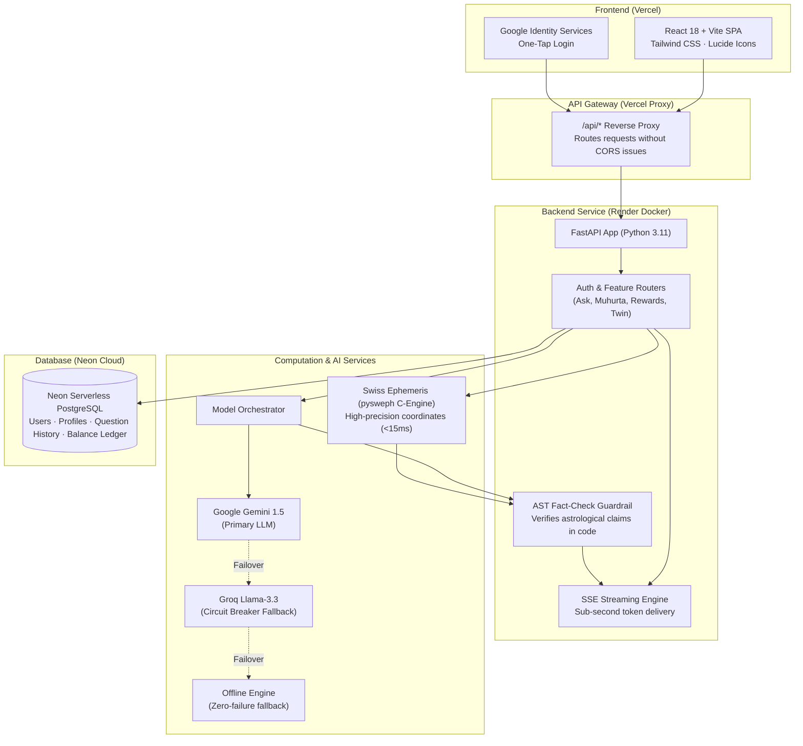

# Melooha Engineering Challenge — Final Submission Report

**Challenge Theme**: *"Help more people discover Melooha, trust it, and come back to it."*

---

## 📌 Submission Overview & Live Links

| Deliverable | URL / Details |
| :--- | :--- |
| **Live Web Application** | [https://astro-psi-olive.vercel.app](https://astro-psi-olive.vercel.app) *(Mobile-first SPA on Vercel)* |
| **Backend API Service** | [https://astro-5qqa.onrender.com](https://astro-5qqa.onrender.com) *(FastAPI Docker on Render)* |
| **Public GitHub Repository** | [https://github.com/AkshatRabgotra/Astro](https://github.com/AkshatRabgotra/Astro) |
| **Core Target Metric** | **Day-7 (D7) Retention & Weekly Active Return Rate (WARR)** |
| **Selected Feature** | **Personalized Muhurta Advisor (Google Calendar Integration) & Daily Rewards Streak** |

---

## 1. App Exploration & Problem Identification

### 1.1 Where Users Drop Off in Melooha
By testing Melooha as a first-time user, two clear drop-off points stood out:

1. **Birth Time Uncertainty during Onboarding**:
   - In India, many users do not know their exact birth minute. When an app forces exact time input, users guess or abandon onboarding.
   - *Our Solution*: Added a clear *"I don't know my exact time"* toggle. The engine calculates planetary signs from solar noon and transparently notes ascendant limitations.
2. **The "Single-Question Drop-off" (The Core Problem)**:
   - Melooha offers 1 free question. The conversational reading is warm, empathetic, and bottom-line first.
   - However, once the first answer is read, the user hits a credit paywall. Because a birth chart feels static, the user feels their questions are answered and has **no clear reason to open the app again tomorrow**.

---

### 1.2 Market Analysis: What Other Apps Do

To understand user expectations, we analyzed five popular astrology and AI applications:

| Application | What They Do Well | Where They Fall Short | How Our Build Solves It |
| :--- | :--- | :--- | :--- |
| **AstroTalk** | Large user base with instant human astrologers. | Expensive per-minute call timers; aggressive sales pushes for poojas and gemstones. | **Private, non-judgmental AI**: Immediate answers with zero upsell pressure. |
| **AstroSage** | Comprehensive traditional chart calculators. | Outdated design with intrusive banner ads; complex jargon that confuses normal users. | **Clean modern UI**: Translates complex planetary positions into clear, practical life advice. |
| **Astroyogi** | Directory of verified astrologers. | Requires booking appointments in advance; high friction and slow turnaround. | **Instant answers**: Sub-second streaming readings available 24/7. |
| **Kundali GPT** | Free-form natural language chat. | High rate of AI hallucinations; frequently invents incorrect planetary positions. | **In-code verification**: Swiss Ephemeris calculates positions; a code guardrail verifies facts before answering. |
| **Naksh** | Minimalist aesthetic. | Static daily horoscope cards; lacks actionable timing tools. | **Actionable daily utility**: Daily auspicious time windows with direct Google Calendar export. |

---

## 2. The Idea: From a One-Time Reading to a Daily Decision Utility

### Target User
Young professionals, students, and life-planners who want practical Vedic timing for day-to-day decisions (job interviews, investments, contracts, travel).

### The Primary Metric
**Day-7 (D7) User Retention and Return Rate**: Moving the user relationship from "ask once a year" to "open every morning for timing guidance."

```
      Traditional Single-Question Flow:
      [Onboarding] ──> [1 Free Question] ──> [Hard Paywall] ──> User drops off (80%+ churn)

      Our Daily Retention Loop:
      [Onboarding] ──> [1 Free Question] ──> [Daily Muhurta Advisor] ──> [Daily Streak (+1 Credit)] ──> Returns on Day 7
```

### The Three Integrated Features:

1. **Personalized Muhurta Advisor (1-Click Google Calendar Sync)**:
   - Computes daily 30-minute astrological windows (Choghadiya, Tithi, Nakshatra, and Tara Bala based on the user's Moon).
   - Lets users click **"Add to Google Calendar"** so auspicious windows appear on their personal schedule.
2. **Daily Reward & Habit Streak**:
   - Encourages daily returns with consecutive check-in streaks.
   - Active users earn free question credits and daily spiritual mantras, removing the dead-end paywall feeling.
3. **Past Check & Dasha Twin (Trust Builders)**:
   - *Past Check*: Verifies the accuracy of the user's chart by checking major past life events against their planetary timeline.
   - *Dasha Twin*: Matches the user's current planetary period with historical figures who shared the same dasha.

---

## 3. Architecture & System Design

### 3.1 Architecture Diagram



---

### 3.2 Engineering Trade-offs & Key Technical Decisions

1. **In-Code Grounding vs. Prompt Engineering**:
   - *Decision*: Rather than hoping an LLM prompt will prevent hallucinations, we calculate true planetary positions using the C-based Swiss Ephemeris (`pysweph`). A Python AST validator checks every planetary reference in the generated text against calculated facts before rendering.
2. **Multi-Provider Reliability**:
   - *Decision*: Model calls route through a three-tier circuit breaker: Primary Google Gemini $\rightarrow$ Groq Llama-3.3-70b $\rightarrow$ Offline deterministic generator. The user never encounters a blank screen or raw server error.
3. **Double-Entry Balance Ledger**:
   - *Decision*: Question credits use an idempotent ledger (`backend/ledger.py`) that prevents double deductions or race conditions during rapid user clicks.
4. **Vercel Reverse Proxy Configuration**:
   - *Decision*: Configured `vercel.json` rewrites so that `/api/*` routes are proxied directly to the Render backend, preventing cross-origin cookie issues and simplifying mobile browser handling.

---

## 4. Standout Highlights (Challenge Section 4)

1. **Background Jobs & Calendar Sync**:
   - Asynchronously creates RFC-5545 calendar payloads and dynamic Google Calendar links.
   - Manages consecutive-day streak verification and reward claims.
2. **Automated Testing Suite (74 Tests Passing)**:
   - Full test coverage across astronomical math, prompt validation, balance transactions, and API flows (`pytest -q` runs in 4.6 seconds).
3. **Living Design System & Bilingual Support**:
   - Documented color tokens and UI components accessible via the built-in Admin Console.
   - Complete bilingual support in **Hindi (हिन्दी)** and **English**.

---

## 5. Local Setup in One Command

```bash
# Clone the repository
git clone https://github.com/AkshatRabgotra/Astro.git
cd Astro

# Start both Backend and Frontend in a single command:
# On Windows:
.\run.ps1

# On Linux / macOS:
make run
```

---

*Submitted for the Melooha Engineering Challenge — November 2026.*
