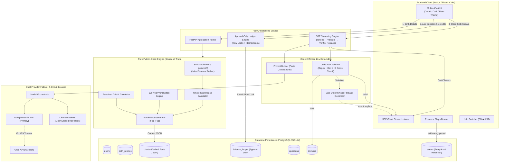
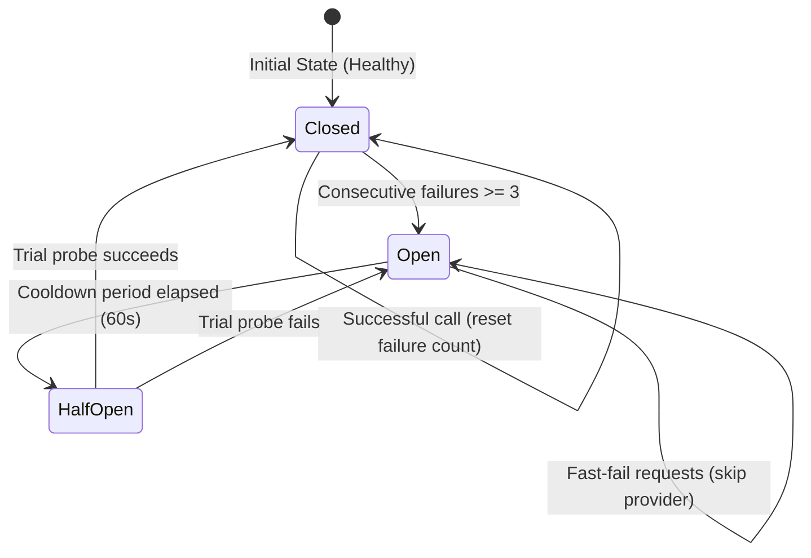

# Melooha AI Vedic Astrology: Architecture & System Design

---

## 1. Core Architectural Pillars

### A. The Chart Engine as the Single Source of Truth
The LLM is **strictly prohibited from calculating astrological coordinates**. 
- Built in pure Python (`chart/`), wrapping Swiss Ephemeris (`pysweph`).
- Uses **Lahiri Sidereal zodiac**, **Whole-Sign houses**, and the **120-year Vimshottari Dasha cycle**.
- Yields a deterministic list of atomic `ChartFact` objects with stable IDs (`F01` to `F21`).
- **Explicit Unknown Birth Time Handling**: If birth time is unknown, `is_time_dependent: True` flags mark the Ascendant and houses as unavailable (`is_available: False`). No ungrounded coordinates are ever guessed.

### B. Append-Only Balance Ledger & Concurrency Safety
User balance is calculated dynamically:
$$\text{Balance} = \sum_{\text{entry} \in \text{Ledger}} \text{amount}$$
- **Signup Grant**: `+1` (idempotent key `signup_{user_id}`).
- **Question Spend**: `-1` (atomic check-and-decrement guarded by per-user mutex serialization and `SELECT ... FOR UPDATE` row locks). Double-clicks and network retries never double-charge.
- **Top-up**: `+N` (free challenge top-up with zero payment).
- **Automatic Failure Refund**: `+1` (if provider call or validation fails after fallbacks, credit is refunded immediately and idempotently).

### C. Streaming Trade-off & Two-Phase Verification Protocol
Streaming LLM responses over Server-Sent Events (SSE) introduces an engineering dilemma:
> *How do you give the user instant sub-second perceived latency while maintaining 100% strict code grounding?*

**The Melooha Solution: Optimistic Streaming with Final Verification Event**
1. **Phase 1 (Stream Draft Tokens)**: The backend streams tokens to the UI as they generate, maintaining $<500$ms Time-to-First-Token (TTFT).
2. **Phase 2 (Code Verification)**: When generation concludes, `AnswerValidator` executes in-memory regex and dictionary verification against the precomputed `ChartFacts`.
   - **Path A (Verified)**: Emits `event: verified` with the list of verified `cited_facts` evidence chips.
   - **Path B (Violation Detected)**: Retries once with error feedback. If ungrounded text persists, emits `event: replace` with a 100% grounded safe templated reading (`llm/fallback.py`) built directly from verified facts.
   - **Path C (Complete Provider Failure)**: Issues automatic `+1` credit refund to `balance_ledger` and emits `event: error` with friendly copy.

---

## 2. Relational Data Model

| Table | Primary Key | Key Attributes | Invariants / Purpose |
| :--- | :--- | :--- | :--- |
| `users` | `id` (UUID) | `name`, `email`, `created_at` | Root identity entity. |
| `birth_profiles` | `id` (UUID) | `user_id`, `birth_date`, `birth_time`, `time_known`, `lat`, `lon`, `timezone_str` | Stores exact geographical and temporal birth parameters. |
| `charts` | `id` (UUID) | `birth_profile_id`, `ayanamsa`, `facts_json`, `calculated_at` | Caches serialized `ChartFacts` to eliminate redundant ephemeris computation. |
| `balance_ledger` | `id` (UUID) | `user_id`, `amount`, `entry_type`, `idempotency_key`, `reference_id` | **Append-only**. Sum of amount equals balance. Unique constraint on `idempotency_key`. |
| `questions` | `id` (UUID) | `user_id`, `birth_profile_id`, `question_text`, `status`, `idempotency_key` | Tracks question lifecycle (`pending`, `completed`, `failed`, `refunded`). |
| `answers` | `id` (UUID) | `question_id`, `answer_text`, `cited_fact_ids`, `provider`, `is_verified` | Stores verified reading and evidence citations. |
| `events` | `id` (UUID) | `user_id`, `event_name`, `payload`, `created_at` | Product analytics powering `/metrics` (retention & evidence views). |

---

## 3. Resilience: Multi-Provider Failover & Circuit Breaker

- **Primary Provider**: Google Gemini API (`gemini-2.0-flash` / `gemini-1.5-flash`).
- **Fallback Provider**: Groq API (`llama-3.3-70b-versatile` / `llama-3.1-8b-instant`).
- **Circuit Breakers**: Independent instances for Gemini and Groq. If Gemini fails 3 times consecutively (e.g. rate-limit HTTP 429 or network timeouts), its circuit trips to `OPEN`. Subsequent user queries skip Gemini immediately without blocking, directing traffic to Groq.
- **Shielded Errors**: Raw HTTP 500s or Python stack traces are never exposed to the user. Instead, the UI renders an empathetic cosmic message and provides an actionable Retry button.
